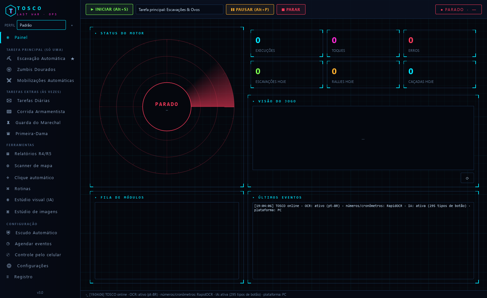
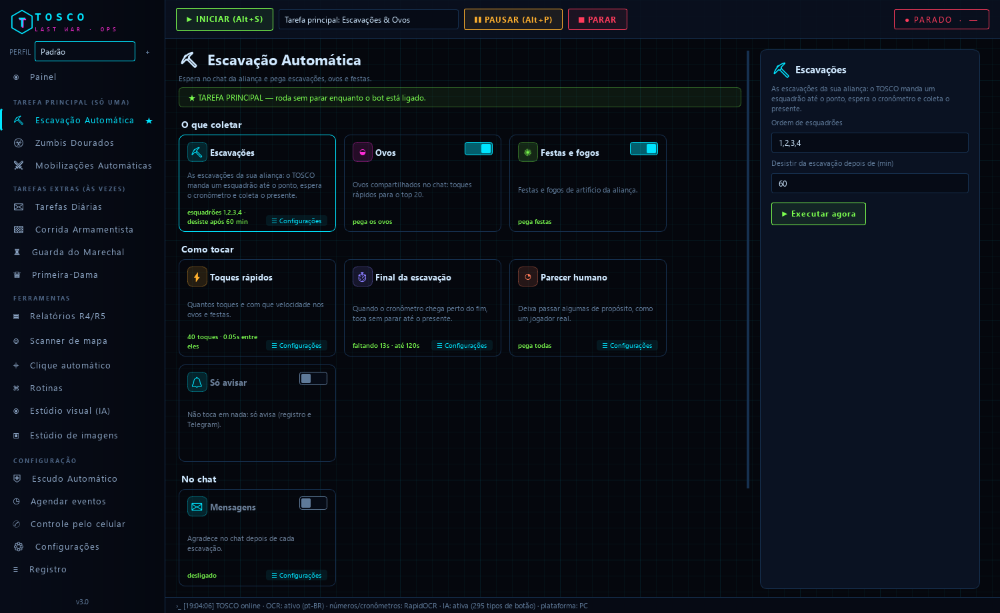
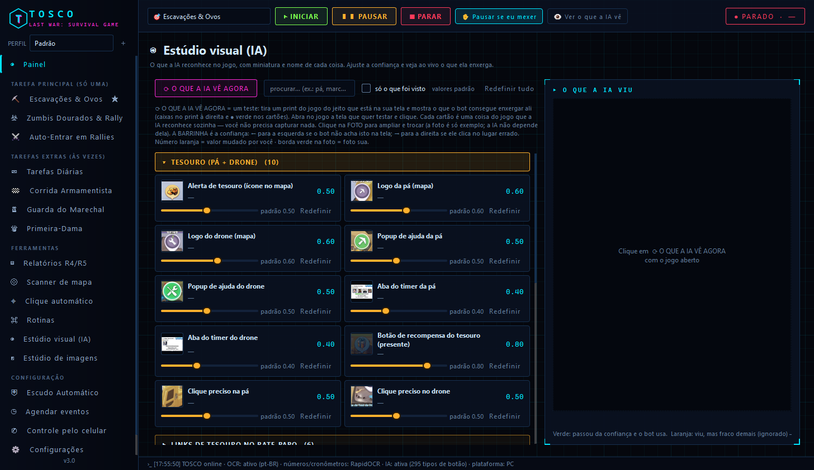
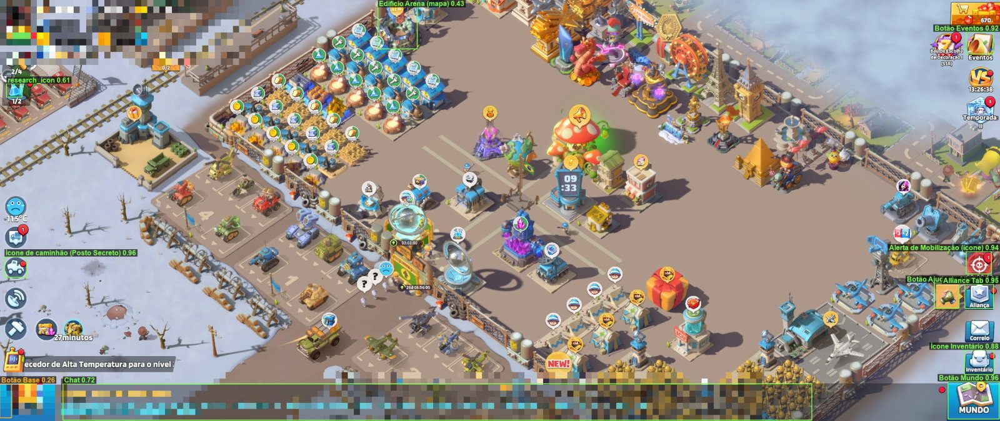
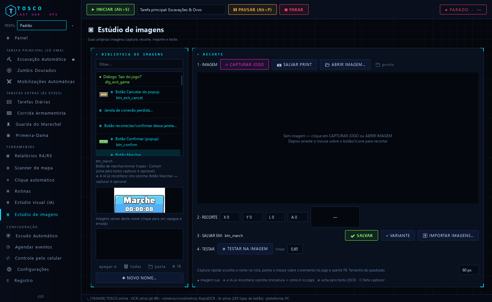
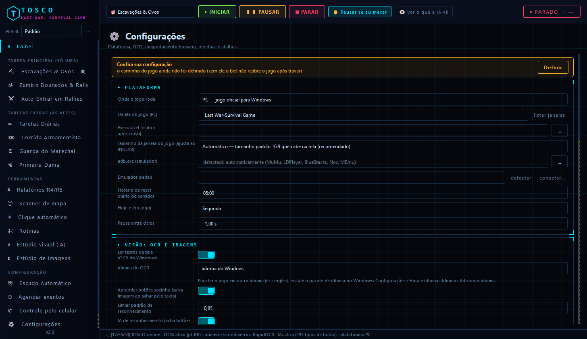

# TOSCO // BOT Last War: Survival Game

Bot para **Last War: Survival** escrito do zero em Python, com interface em português no estilo HUD.
Roda no **jogo oficial de PC** ou em **emulador Android** (BlueStacks, MuMu, LDPlayer… via ADB, em segundo plano).

O TOSCO **só olha a tela e toca**, como uma pessoa: não lê a memória do jogo, não mexe na rede e não altera
nenhum arquivo do jogo.



---

## O que ele faz

| Grupo | Módulos |
|---|---|
| **Tarefa principal** (roda sem parar, escolha uma) | **Escavação Automática** — escavações, drone, ovos e festas da aliança · **Zumbis Dourados** · **Mobilizações Automáticas** — entra nos rallies dos chefes que você escolher, do maior nível que cabe no seu limite |
| **Tarefas extras** (entram entre as rodadas) | Tarefas Diárias (loja grátis, trem, VIP, correio, baús) · Recursos · Ajuda e Tecnologia da Aliança · Esquadrão Secreto · Caminhões · Coleta no Mapa · Arena 3v3 · Corrida Armamentista · Guarda do Marechal · Primeira-Dama (cargos) |
| **Ferramentas** | Relatórios R4/R5 em planilha · Scanner de mapa com botão **IR** · Clique automático · Rotinas que você mesmo escreve · **Estúdio visual (IA)** · **Estúdio de imagens** |
| **Configuração** | Escudo automático · Agenda (liga, desliga ou roda módulos por dia e hora) · Controle pelo celular (Telegram) · Registro de tudo |

Cada módulo tem dias da semana e horário próprios.



---

## Como ele enxerga o jogo

Para cada botão, o TOSCO tenta nesta ordem: **imagem sua → IA → texto na tela (OCR)**.

- **IA de reconhecimento** — um modelo incluído reconhece sozinho **295 tipos de botões e ícones** do jogo
  (Base/Mundo, chat, escavações, cronômetro, presente, alerta de rally, esquadrões, Marchar, X de fechar…), em
  qualquer resolução e idioma. Você **não precisa capturar nada** para começar.
- **Números e cronômetros** — lidos pelo **RapidOCR** (~11 ms por cronômetro). O OCR do Windows não lê a fonte
  dos cronômetros do jogo; o Tesseract fica como reserva.
- **Botões com texto** (Confirmar, Reivindicar Tudo, Participar, Marchar…) — achados pelo texto, com as palavras
  **exatas que o jogo usa em português**, e salvos como imagem para ficar mais rápido.
- **Qualquer tamanho de janela** — a interface do jogo cresce pela **altura** da janela; o TOSCO escala as
  imagens do mesmo jeito, então funciona em janela larga ou estreita.

### Estúdio visual (IA)

Mostra, com **miniatura e nome em português**, cada uma das coisas que a IA reconhece, agrupadas por assunto
(Tesouro, Bate-papo, Comuns, Esquadrões, Recuperação, Aliança, Presente da Sorte, Arena, Posto Secreto…).

- **⟳ O QUE A IA VÊ AGORA** tira um print do jogo e marca em cada cartão o que foi visto:
  verde = reconhecido e usado · laranja = visto, mas fraco demais (ignorado).
- A **barrinha** de cada cartão é a confiança: para a esquerda se o bot **não acha** aquilo na tela; para a
  direita se ele **clica no lugar errado**. **Redefinir** volta ao padrão.
- **Clique na foto** para ampliá-la ao lado de como aquilo está **no seu jogo agora**, e trocar a foto de
  exemplo pelo recorte do seu jogo — o recorte também vira a imagem do Estúdio de imagens.





### Estúdio de imagens

Para as suas próprias imagens, em 4 passos: **1** capturar o jogo, salvar o print ou abrir uma imagem ·
**2** recortar arrastando o mouse ou pelos números (X, Y, largura, altura) · **3** salvar, como variante ou
importando imagens prontas · **4** testar na imagem. Os nomes que a IA já conhece aparecem com a miniatura do
jogo e o botão **◉ IA** abre o mesmo item no Estúdio visual. **F8** captura direto do jogo com o mouse em cima.



---

## Proteção da sua conta

- **Nunca toca perto de compra**: antes de cada toque ele lê a área em volta e bloqueia "Comprar", preços
  (R$, $, €), "Finalizar agora", "Acelerar instantaneamente com Diamantes", "Usar N diamantes",
  "Teleportar" e "Excluir tudo".
- **Pausa quando você mexe no PC** — o mouse é o mesmo; ele solta o controle e volta depois de 20 s parado.
- **Tempo máximo por tarefa** — se uma tarefa trava, ele interrompe e volta à tela principal.
- **Reconhece telas** (carregando, manutenção, conexão perdida, conta aberta no celular, sair do jogo…) e espera
  em vez de tocar; conta aberta no celular → reconecta depois de 10 min.
- **Recuperação** — volta à tela principal sozinho; se travar várias vezes seguidas, reinicia o jogo.
- Ignora a faixa do chat da tela principal (tocar ali abria o chat por engano).

---

## Começo rápido

1. Baixe ou compile o `TOSCO.exe` e deixe ao lado dele a pasta `data` (com `data\modelos` e `data\miniaturas`).
2. Abra o jogo. No TOSCO, em **Configurações**, confira a janela do jogo (padrão `Last War-Survival Game`).
   Para emulador, escolha *Emulador Android (ADB)* e clique em *detectar*.
3. Ligue os módulos que quiser e clique em **INICIAR**.

Atalhos: Iniciar `Alt+S` · Pausar `Alt+P` · Retomar `Alt+R` · Parar `Alt+Q` · Clique automático `Alt+C` ·
Captura rápida `F8`.



### Telegram (controle pelo celular)

No Telegram, fale com `@BotFather` → `/newbot` → copie o token para **Controle pelo celular**. Mande "oi" para o
seu bot e clique em *descobrir meu chat ID*. Comandos: `/status` `/print` `/iniciar` `/parar` `/pausar`
`/retomar` `/log` `/modulos` `/ligar <id>` `/desligar <id>` `/agora <id>` `/clicker`.
Com o aviso de escavações ligado, ele manda o **print da recompensa** de cada escavação.

---

## Rodar pelo código-fonte

Precisa de **Windows 10/11** e **Python 3.12**.

```bash
python -m pip install --user -r requirements.txt
```

```bash
python main.py
```

Para gerar o executável, rode `build.bat`: ele instala as dependências, baixa os modelos do RapidOCR e cria
`dist\TOSCO.exe` (um arquivo só).

O Tesseract é opcional (reserva para números): `winget install UB-Mannheim.TesseractOCR`.

### Pastas

| Pasta | O que tem |
|---|---|
| `tosco/core` | motor, agendador, visão (imagens, IA, OCR), reconhecimento de telas, proteção dos toques |
| `tosco/tasks` | os módulos (escavação, rally, diárias…) |
| `tosco/ui` | a interface (painel, estúdios, páginas dos módulos) |
| `data/modelos` | modelo da IA (`lw_preciso.onnx` e `lw_rapido.onnx`) |
| `data/miniaturas` | fotos de exemplo do Estúdio visual |
| `data/templates` | imagens capturadas por você |

As configurações, o token do Telegram, os logs e os relatórios ficam em `data` no seu PC e **não** vão para o
repositório.

---

Automação pode violar os termos de uso do jogo; use por sua conta e risco.
